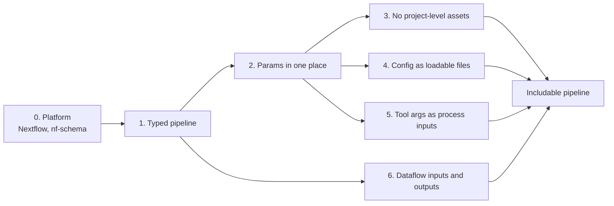

# Making a pipeline composable

With [pipeline composition](https://github.com/nextflow-io/nextflow/blob/master/adr/20260608-pipeline-composition.md),
one Nextflow pipeline can include another and call it like a workflow. Both run in one session and one DAG, and the
outputs of one pipeline can be the inputs of the next. This page is for developers who want other pipelines to include
their pipeline. It gives the changes in the order they depend on each other.

nf-core/rnaseq and nf-core/differentialabundance are the worked examples. This repository is the pipeline that
includes them.



## 0. Platform

- Nextflow 26.10.0 or later. It contains pipeline composition
  ([nextflow#7213](https://github.com/nextflow-io/nextflow/pull/7213)).
- nf-schema with [#230](https://github.com/nextflow-io/nf-schema/pull/230),
  [#232](https://github.com/nextflow-io/nf-schema/pull/232) and
  [#234](https://github.com/nextflow-io/nf-schema/pull/234). These let nf-schema validate `Channel` params and nested
  params. They are merged but not released, so this repository uses a patched build (`2.7.2-channel.5`).

## 1. Make the pipeline typed

Convert to static types: records, typed processes and workflows, a typed `params {}` block, and an `output {}` block
in place of `publishDir`.

**Why:** a pipeline can only be included if it is typed. Its `params` block becomes the call signature, and its
`output` block becomes what the caller receives. Files published with `publishDir` cannot reach the caller.

**Example:** [rnaseq#1945](https://github.com/nf-core/rnaseq/pull/1945). The plan and the conventions are in
[rnaseq#1931](https://github.com/nf-core/rnaseq/issues/1931). This step is a modernisation that is useful by itself.

## 2. Read params in one place

- Declare every pipeline param, with its default, in the typed `params {}` block.
- Keep only config params (params that only change config) in a config file.
- Read `params` only in the entry workflow and the `output` block. Pass them to subworkflows and helpers as inputs,
  including the template's `PIPELINE_INITIALISATION` and `PIPELINE_COMPLETION`.

**Why:** the `nextflow.config` of an included pipeline is not loaded, so defaults there are lost. Outside the entry
workflow, the global `params` belongs to the including pipeline, so code there reads the wrong values.

## 3. Use no project-level assets

Use `moduleDir` instead of `projectDir`, module templates instead of `bin/`, and no `lib/`.

**Why:** in an included pipeline, `projectDir` is the root of the including pipeline, and `bin/` is not on the process
path.

## 4. Ship config as loadable files

Put config params in `conf/params.config` and process config in `conf/modules.config`. Include both from
`nextflow.config`, so that a standalone run works as before. Write process selectors that also match when the names
start with an include alias (for example `NFCORE_RNASEQ:`).

**Why:** the including pipeline must load your process config itself, and it calls your pipeline under an alias.

## 5. Make tool arguments process inputs

Build tool arguments from params in workflow code and give them to the process as an input. The process uses
`task.ext.args` first, so users can still replace the arguments in config:

```groovy
def args = task.ext.args ?: sample.args ?: ''
```

**Why:** a config closure such as `ext.args = { params.extra_star_align_args }` reads the including pipeline's
`params`, so the value the user gives to your pipeline has no effect.

**Examples:** two forms exist.

- [rnaseq#1966](https://github.com/nf-core/rnaseq/pull/1966) builds one `ToolArgs` record and attaches each string to
  the module's input record.
- [methylseq#626](https://github.com/nf-core/methylseq/pull/626) builds an options map per tool, renders it with a
  `cli()` helper, and removes `conf/modules/`.

This step changes modules, so the pipeline's modules differ from nf-core/modules until the change is made there.

## 6. Take dataflow inputs and return outputs

- Make inputs that an upstream pipeline could produce into dataflow params. Examples: a samplesheet as
  `Channel<SampleRow>`, validated with nf-schema `validate()`, or a file as `Value<Path>?`.
- Return the outputs that a downstream pipeline needs, for example merged count matrices and the annotation.
- Remove the `outdir` param. The output location is `-output-dir`.

**Why:** without these changes, the input can only be a path on the command line, and the outputs can only be files
on disk.

**Examples:** [rnaseq#1966](https://github.com/nf-core/rnaseq/pull/1966) (steps 2 to 6, on top of step 1) and
[differentialabundance#758](https://github.com/nf-core/differentialabundance/pull/758) (steps 1 to 6 in one PR).

## The including pipeline

When the steps above are done, the including pipeline is small. See [`main.nf`](../main.nf):

```groovy
include { params as RnaseqParams ; workflow as NFCORE_RNASEQ } from './pipelines/nf-core/rnaseq'

params {
    rnaseq: RnaseqParams    // set by the user as --rnaseq.<name>
}

workflow {
    rnaseq = NFCORE_RNASEQ(params.rnaseq)
    // connect rnaseq.gene_quant to the next pipeline
}
```

An included pipeline contributes only its scripts. The including pipeline supplies the manifest, plugins, containers,
resources and each component's `conf/` files ([`nextflow.config`](../nextflow.config)). It also needs one schema that
contains the schemas of its components ([`scripts/combine_schemas.py`](../scripts/combine_schemas.py)).

## Open questions in nf-core

These items do not stop a composed pipeline from running. They must be decided before nf-core pipelines can adopt the
changes:

- **Lint and template.** nf-core lint does not read the typed `params {}` block. The template functions read the
  global `params`. `nf-core pipelines schema build` cannot combine schemas. See
  [nf-core/tools#4493](https://github.com/nf-core/tools/issues/4493) and
  [nf-core/tools#4491](https://github.com/nf-core/tools/pull/4491).
- **Tool argument convention** (step 5). One record or separate inputs, strings or option maps, and whether
  `conf/modules/` stays. This changes nf-core/modules, so it needs community agreement.
