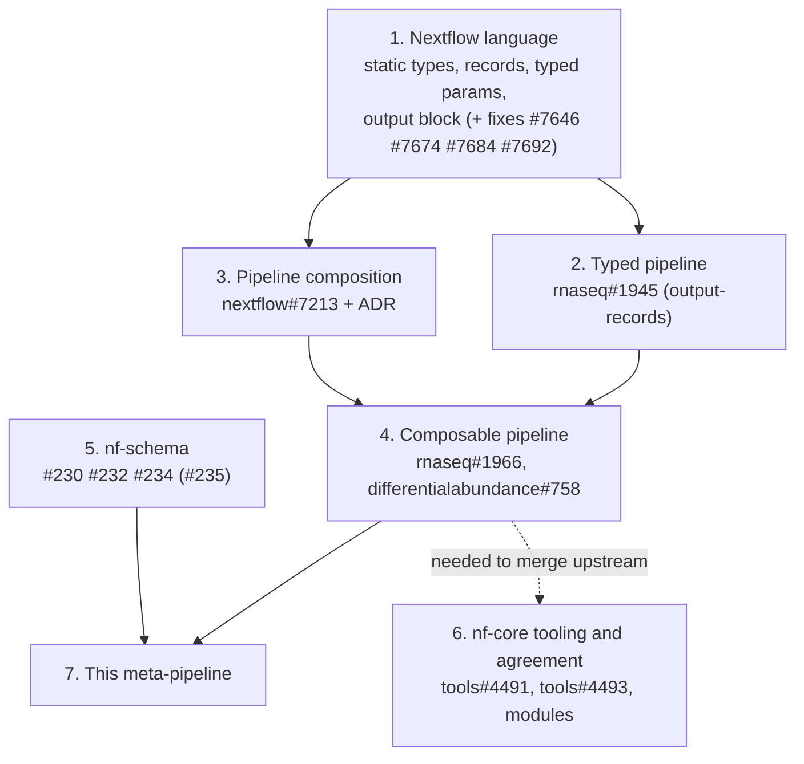

# The path to composable nf-core pipelines

This page describes how nf-core/rnaseq and nf-core/differentialabundance became pipelines that another pipeline can
include. Each step depends on the step before it. Read it from top to bottom.

Status as of 2026-10-15. Each item links to its PR or issue. The [table at the end](#where-each-item-stands) shows which
items are merged, released or still open.



## 1. Nextflow language features

Composition needs typed Nextflow: a typed `params {}` block, records, typed processes and workflows, and the workflow
`output {}` block. These exist in Nextflow already. The rnaseq conversion found gaps, which Nextflow fixed:

| PR | Fix |
| --- | --- |
| [nextflow#7646](https://github.com/nextflow-io/nextflow/pull/7646) | An output `path` closure can return a map of files to targets. |
| [nextflow#7674](https://github.com/nextflow-io/nextflow/pull/7674) | No crash when every publish statement of an output is a no-op. |
| [nextflow#7684](https://github.com/nextflow-io/nextflow/pull/7684) | Record casts work with non-local `Path` values. |
| [nextflow#7692](https://github.com/nextflow-io/nextflow/pull/7692) | Record fields of process inputs are validated at runtime. |

Related issues: [nextflow#7719](https://github.com/nextflow-io/nextflow/issues/7719) (typed `join` has no
`failOnMismatch`) and [nextflow#7720](https://github.com/nextflow-io/nextflow/issues/7720) (lint rejects plugin
functions in typed scripts).

## 2. Make the pipeline typed (rnaseq#1945)

**Why first:** the [composition ADR](https://github.com/nextflow-io/nextflow/blob/master/adr/20260608-pipeline-composition.md)
requires static typing in the included pipeline and in the pipeline that includes it. A pipeline is included as its
`params` / `workflow` / `output` trio. The `params` block is the call signature. The `output` block becomes the
`emit:` section. If a pipeline publishes with `publishDir`, the including pipeline cannot receive those results as
channels.

[nf-core/rnaseq#1945](https://github.com/nf-core/rnaseq/pull/1945) (`output-records`) does this conversion. The plan is
in tracking issue [#1931](https://github.com/nf-core/rnaseq/issues/1931), which has three phases:

1. **Records** ([#1933](https://github.com/nf-core/rnaseq/issues/1933), PR [#1939](https://github.com/nf-core/rnaseq/pull/1939)).
   Each stage emits per-sample result records keyed on `id`.
2. **Output block** ([#1934](https://github.com/nf-core/rnaseq/issues/1934), PR [#1944](https://github.com/nf-core/rnaseq/pull/1944)).
   One `output {}` block replaces every `publishDir`. `--outdir` becomes `-output-dir`.
3. **Static types** ([#1935](https://github.com/nf-core/rnaseq/issues/1935)). Every module and workflow is typed, and
   every module emits one record.

Follow-up PRs made the published files match `dev`:
[#1954](https://github.com/nf-core/rnaseq/pull/1954), [#1956](https://github.com/nf-core/rnaseq/pull/1956),
[#1960](https://github.com/nf-core/rnaseq/pull/1960), [#1961](https://github.com/nf-core/rnaseq/pull/1961),
[#1964](https://github.com/nf-core/rnaseq/pull/1964).

The result works by itself. It is a modernisation, and it does not need composition.

## 3. Pipeline composition in Nextflow (nextflow#7213)

[nextflow#7213](https://github.com/nextflow-io/nextflow/pull/7213) adds pipeline inclusion:

```groovy
include { params as RnaseqParams ; workflow as NFCORE_RNASEQ } from './pipelines/nf-core/rnaseq'
```

The included `params` block is a record type. A user sets its values as `--rnaseq.<name>`. The included pipeline runs
in the same session, DAG and work directory as the including pipeline. Its outputs are channels.

The ADR lists five best practices. Step 4 applies them:

1. Declare pipeline params in the script `params` block, and read them only in the entry workflow and the `output`
   block. Config declares only config params.
2. Do not use `projectDir`, `bin/` or `lib/`. Use `moduleDir` and module resources.
3. Put `ext` defaults in the process definition, or replace them with process inputs.
4. Declare `container` and `conda` in the process, not in config.
5. Publish with the `output` block, not `publishDir`.

[nextflow#7759](https://github.com/nextflow-io/nextflow/pull/7759) serializes `Channel` and `Value` params as plain
values, so Seqera Platform and lineage records work with them.

## 4. Make the pipeline composable (rnaseq#1966, differentialabundance#758)

[nf-core/rnaseq#1966](https://github.com/nf-core/rnaseq/pull/1966) is based on #1945 and holds only what composition
needs. [nf-core/differentialabundance#758](https://github.com/nf-core/differentialabundance/pull/758) makes the same
changes to differentialabundance, which was not typed before. Each change below fixes a specific failure that happens
when the pipeline is included:

| Change | What fails without it |
| --- | --- |
| **All params in the typed `params {}` block.** Config-only params move to `conf/params.config`. | The `nextflow.config` of an included pipeline is not loaded, so defaults that are only in that file are lost. |
| **Params are passed in.** `NFCORE_RNASEQ`, `PIPELINE_INITIALISATION` and `PIPELINE_COMPLETION` take `params` as an input. | Outside the entry workflow, the global `params` is the including pipeline's params, so the code reads wrong values. |
| **`moduleDir` instead of `projectDir`. Module templates instead of `bin/`.** | `projectDir` is the root of the meta-pipeline. `bin/` is not on the process path of an included pipeline. |
| **Config split into loadable files** (`conf/params.config`, `conf/modules.config`). Process selectors accept an alias prefix. | The meta-pipeline cannot get the process config. Selectors do not match when the process names start with `NFCORE_RNASEQ:`. |
| **Tool arguments are process inputs.** A `ToolArgs` record is built from params, and each subworkflow takes it as `tool_args`. A module uses `task.ext.args ?: sample.args`. | `ext.args = { params.x }` reads the meta-pipeline's `params`, so `--rnaseq.extra_star_align_args` has no effect. |
| **Outputs are returned, not only published.** rnaseq returns `gene_quant` and `gtf`. There is no `outdir` param. | The meta-pipeline cannot connect rnaseq to differentialabundance. |
| **Inputs are dataflow.** rnaseq `input` is `Channel<SampleRow>`, validated with nf-schema `validate()`. differentialabundance `matrix`, `gtf` and similar inputs are `Value<Path>?`. | The input can only be a file path on the command line. An upstream pipeline cannot give it. |

Standalone runs work as before: each pipeline's `nextflow.config` includes the same split files.

Ben Sherman compared #1966 with his approach in
[nf-core/methylseq#626](https://github.com/nf-core/methylseq/pull/626). The approaches agree on params and inputs.
For tool arguments, methylseq builds an options map and renders it with a `cli()` helper. Methylseq also removes
`conf/modules/` completely.

## 5. nf-schema

nf-schema validates params and samplesheets. Typed and nested params need these fixes:

| PR | Fix |
| --- | --- |
| [nf-schema#230](https://github.com/nextflow-io/nf-schema/pull/230) | `validateParameters` validates `Channel` and `Value` params. Before this fix, it blocks indefinitely. |
| [nf-schema#232](https://github.com/nextflow-io/nf-schema/pull/232) | A referenced schema is found next to the schema that references it, not in `projectDir`. |
| [nf-schema#234](https://github.com/nextflow-io/nf-schema/pull/234) | Command-line values of nested params (`--rnaseq.skip_qc true`) are cast to their types. |
| [nf-schema#235](https://github.com/nextflow-io/nf-schema/pull/235) (open) | Uses the plain param values from nextflow#7759 and removes nf-schema's own workaround. |

These fixes are merged but not released, because nf-schema 3.0.0 was released before them. Until a release includes
them, this repository and the component branches use a patched build, `2.7.2-channel.5`.

## 6. nf-core tooling and agreement

The steps above are sufficient for the meta-pipeline to run. The component PRs cannot be merged to nf-core until these
items are done:

- **Lint crash on record imports.** `nf-core pipelines lint` and `subworkflows install` read type includes as module
  dependencies. Fix: [nf-core/tools#4491](https://github.com/nf-core/tools/pull/4491).
- **Lint and template for typed pipelines.** [nf-core/tools#4493](https://github.com/nf-core/tools/issues/4493), part
  of [#3773](https://github.com/nf-core/tools/issues/3773), asks:
  - Can lint read defaults from the typed `params {}` block? `nextflow_config` and `schema_params` fail for every
    param, and differentialabundance ignores these checks in `.nf-core.yml`.
  - Can the template functions take `params` as an input? This changes their signatures.
  - What replaces `${projectDir}` defaults in `nextflow_schema.json`?
  - Can `nf-core pipelines schema build` build a schema for a pipeline that includes other pipelines? This
    repository uses `scripts/combine_schemas.py` for now.
- **Modules.** rnaseq edits its vendored modules in place: they have record input types and an `args` input. It does
  not use `nf-core modules patch` files, because of [nf-core/tools#3157](https://github.com/nf-core/tools/issues/3157).
  These changes must go into nf-core/modules before rnaseq can use `nf-core modules update` again.
- **Tool argument convention.** This is the change that most needs community agreement: one `ToolArgs` record or
  separate inputs, a string or an options map, and keeping or removing `conf/modules/`.

## 7. This meta-pipeline

When steps 1 to 5 are done, the meta-pipeline is small. [`main.nf`](../main.nf) includes the two pipelines and
connects rnaseq's `gene_quant` and `gtf` to differentialabundance. The ADR says that an included pipeline contributes
only its scripts, so [`nextflow.config`](../nextflow.config) supplies these items:

- the manifest
- the nf-schema plugin
- containers, resources and the process environment
- each pipeline's `conf/params.config` and `conf/modules.config`

[`nextflow_schema.json`](../nextflow_schema.json) combines the two pipelines' schemas.

## Where each item stands

| Item | State | Blocks |
| --- | --- | --- |
| nextflow#7646, #7674, #7684, #7692 | Merged, released (26.10.0) | rnaseq#1945 |
| nextflow#7213 (composition) | Merged, released (26.09.2-edge, 26.10.0) | Any composition |
| nextflow#7759 (plain dataflow params) | Merged, released (26.10.0) | Platform launches, nf-schema#235 |
| rnaseq#1945 (typed, output block) | Open, targets `dev` | rnaseq#1966 |
| rnaseq#1966 (composable rnaseq) | Open, targets `output-records` | Upstream composition of rnaseq |
| differentialabundance#758 | Open, targets `dev` | Upstream composition of differentialabundance |
| nf-schema#230, #232, #234 | Merged, not released | Removing the patched nf-schema |
| nf-schema#235 | Open | Cleanup only |
| nf-core/tools#4491 | Open | nf-core lint on typed pipelines |
| nf-core/tools#4493 | Open, needs a decision | Template, lint and schema conventions |
| Module changes (`args` inputs, record types) | Vendored only | `nf-core modules update` in rnaseq |
